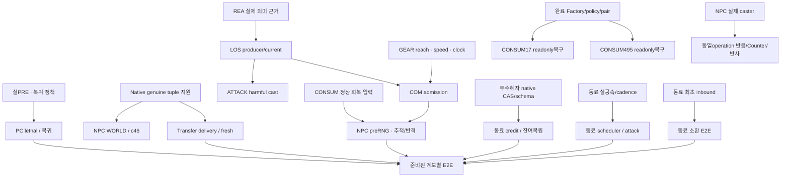

# 전투·동료 법사 전체 실행 계획

기준일: 2026-10-25. 지원 목록 안의 전투·회복·사망·보상·저장·재접속·동료 법사 연속 플레이를 목표로 한다.
이 문서는 최신 현황과 웹 GPT 제안을 대조해 채택한 현행 배정 계획이다. 제품 구현·실행 결과 자체는 아니다.
기존 `COMBAT_COMPLETION_PLAN.md`의 당시 검토·근거·Source와 실결과는 역사 기록으로 보존한다.

## 1. 승인·역할·근거

인간 직접 요청: “계획 업데이트 해줘 동료 법사도 계획에 추가하고 웹 gpt한태 계획 세워달라해 계획받으몀 병렬처리 가능한 구현은 최대한 병렬처리해”.
웹 계획은 수신 완료했다. 기존 작업은 계속하며, 새 계획의 독립 Source 작업을 원담당 안에서 병렬 배정할 수 있다.
동료는 이번 요청 범위의 새 독립 Source 구현을 포함한다. 과거 회수전용 기록만으로 새 계획 전체를 다시 정지하지 않는다.
동시에 old166 hold·과거 Source·시험을 일괄 해제하거나 재발주하지 않는다. Warehouse 원담당·BOOK 전용·무관한 Pro hold도 유지한다.
이 문서는 새 승인 대기나 전기능 준비 gate를 만들지 않는다. 필수 외부 입력이 없는 경로는 정확한 접점과 UNKNOWN을 보존한다.

| 근거 | 범위와 한계 |
| --- | --- |
| [웹 요청](../work/local_original_session/integration-1/web-plan-refresh-companion-20261025/request.txt) | 원담당 현황·사용자 범위·쓰기 소유를 제공한 입력 |
| [웹 응답 원문](../work/local_original_session/integration-1/web-plan-refresh-companion-20261025/web-response.txt) | 외부 계획 제안. 원문 수정 없이 보존 |
| [수신 기록](../work/local_original_session/integration-1/web-plan-refresh-companion-20261025/web-request-receipt.json) | 실제 웹 대화·수신 결과 근거 |
| [웹 대화](https://chatgpt.com/uc/6adde10e-ce64-83ea-aa6c-4f2c49b32a37) | anonymous Default, outcome complete. 로컬 checkout/dirty Source 직접 열람 없음 |
| [ACTIVE_TASK](ACTIVE_TASK.md) | 최신 완료 결과·발주·현재 POST·담당·소유 경계. 과거 entry보다 맨앞 최신 기록 우선 |
| [기존 COMBAT 계획](../work/local_original_session/implementation-5/combat-adjudication/COMBAT_COMPLETION_PLAN.md) | 기존 0~10 목표·수식·수용 근거·P0 Source 후속 |
| [NPC HANDOFF](../work/local_original_session/implementation-2/npc-motion-goal/HANDOFF.md) | 254 UIDburn, lifetime 접점, WORLD/Delivery/c46 caller |
| [GEAR API](../work/local_original_session/equipment-window/API.md) | 후속 01a17278, 실제 PASS와 진단 Source-only 경계 |
| [BUFF HANDOFF](../work/local_original_session/implementation-3/skill-buff/HANDOFF.md) | 253 효과 PASS·255 owned195 실패·후속 caller |
| [CONSUM HANDOFF](../work/local_original_session/consumables/HANDOFF.md) | 최종 Factory 공급·17v16/495v15 연결·readonly 복구 경계 |
| [ATTACK HANDOFF](../work/local_original_session/attack-magic/HANDOFF.md) | Book/host·tick5 app4/outer3 Source·초기 status 미공급 |
| 웹 요청 §4 동료 현황 | Test157 제한 PASS·소환/scheduler/Heal0/EXP/복원 범위. 동료 원담당이 자기 최신 HANDOFF를 승계 |

웹 제안에서 다음을 교정해 채택했다.
- d45 lethal 수정·death guard/PRE는 **Source/접점**이다. PC 사망 실제 PASS 표에 넣지 않는다.
- “NPC 이동 PASS”는 actual198의 반격 HP 저장과 PCMove 저장까지다. NPC 추적·연속 이동 성공으로 확대하지 않는다.
- 웹 DAG의 `ATK-01` 표기는 이 문서의 `CAST-01`로 통일한다.
- 기능 main은 완료 Source, Test는 완료 결과를 공식 도구로 enqueue한다. 통합만 claim/선정/complete·Test발주를 한다.
- Test 단독 공용 API는 `packet-test-client-v5/ready_current/API.md` 계열이다. MAP/Broker 제품 API는 원MAP writer가 소유한다.
- 웹의 동료 공용 파일 공동 담당 표기는 아래 단일 writer 분할로 바꾼다. 동료 원담당이 COMBAT·SKILL/HP를 대신 쓰지 않는다.
- COMBAT의 allied-basic-attack 후손은 COMBAT 한 writer가 기존 승인으로 진행한다. 동료와의 공동승인이나 새 permission gate를 뜻하지 않는다.
- 웹의 “즉시 착수”는 이미 끝난 component를 다시 만드는 지시가 아니다. 실제 새 delta 또는 필수 입력 접점만 대상이다.

## 2. 현재 완료 범위와 남은 목표

`PASS`는 원 실행 계보의 판정 범위, `SOURCE`는 구현/접점 준비, `OPEN`은 미연결·미실행, `UNKNOWN`은 자료 부족이다.
서로 다른 Resource·Store·캐릭터 계보의 성공을 합산하지 않는다. 완료율 숫자는 산출하지 않는다.

| 묶음 | 재사용할 실제 PASS | Source만 준비된 부분 | 남은 입력·완료 기준 |
| --- | --- | --- | --- |
| 0 실행 선정 | 단위별 선정·최신 POST/결과 보존 운영 | manifest/cohort/loader/caller | 각 실행의 같은 family·현재 입력·RUN·정리 완결 |
| 1 운영 LOS | 운영 벽·문 차폐 PASS 없음 | consumer/cold/query/current·preRNG/prewire 거절 | map/projectile 의미·door current/revision/open/geometry/lease; 정상·차단·UNKNOWN 구별 |
| 2 PC 물리 | 148 hit/miss·NPC6→0, 198 NPC6→5 | helper/getter/sameDATA cold3·NPC exact9b6d caller | 실 reach/speed/effect/clock/due/LOS를 RNG 전 admission에 연결 |
| 3 NPC 반격·추적 | 198 PC10→5 COMMITTED/DRAINED·PCMove 저장 | mover 전달 수정·현재 좌표 후손 | 새 위치 추적·연속 반격·LOS·정상 회복 이후 다음 행동 |
| 4 장비·버프 | GEAR235/237/244/250, BUFF240/253 한정 | StatsWeight·refresh/expiry/remove·진단 e256/3889 소비 | live posttrade publication·지원 효과 만료/제거/복원·다음 물리 입력 |
| 5 NPC 사망·보상 | 163 자연35처치·EXP125→300·level3·저장/fresh | native birth/adoption/capacity/delivery/fresh·c46 | 254 lifetime 지원 후 실제 출생→kill→보상/실수신→재생성/fresh |
| 6 PC 사망·복귀 | 전체 lethal/복귀 실제 PASS 없음 | d45 수정·기성 death guard·PRE 접점 | 실제 reader/sample/OBSERVED·호환 family·정식 복귀/패널티 입력 |
| 7 공격·상태마법 | Mage60 초기화는 공격마법 PASS가 아님 | Book7/migration5/caller4·cost/partial·VisibilityGuard | positive host·Book/current38·학습/재료·harmful commit·효과/응답 |
| 8 incoming·반사 | 실제 NPC caster/Counter 전체 PASS 없음 | castStats incoming readonly facts·방어 접점 | known spell/AI operation·MP/cooldown/current·StatusResult·동일 operation 소비 |
| 9 독/tick/범위/proc | 실제 공격마법·Poison 전체 PASS 없음 | tick5 app4/outer3·PD/NPC life/storage 소비 | actual41/host·초기 status·면역/FOG/COUNTER/제거/cure·정책/LOS·대상별 결과 |
| 10 연속 저장 | 성장159/163·단일 복원186·장비 제한 fresh | JSON Store747/Joint1ec→policy1c81→Factory/builder | CONSUM readonly 복구 뒤 Use·10초 active/expiry/fresh; 연속 전투·회복·사망복귀 |
| 동료 법사 | Test157 F101→typed 제거→Restart→strictclose/fresh | 소환/lease/RESOURCE/pose·모드·admission/physical·splitEXP·Heal0 Rule0 | 최초 inbound·실 cadence·시전/효과·두 수혜자 CAS·lethal/전체 복원 |

최신 부분 결과는 다음처럼 보존한다.
- NPC254: WORLD42응답 뒤 `NPC_BORN_SOURCE_LIFETIME_KEY`; 첫 native event `NATIVE_ISSUE_PENDING/receiptNone`.
- 37 NPC UID536871549..536871585 burn, next536871586/rev26. 다른9파일 불변·Native4 저장/ISSUE37 성공 미관측.
- BUFF253: 599CAST95 COMMITTED/DRAINED, MP346→336·효과/수치 PASS. capacity1500→1680은 해당 producer 범위다.
- 195는 nativeBUY96 DRAINED가 있으나 원253 rawBUYFAILED 판정은 그대로다. 소급 PASS·typed 과거 영수증 발명 금지.
- BUFF255: 정상 WORLD 뒤 owned195 case guard 실패·사업행동0. 최신9BUFF asset106/SKILL97, cash96/MP336/UID1830Q1 보존.
- BUFF240의 시전/효과/방어력 PASS와 expiry/restore UNKNOWN을 분리한다. 601 CAST90 WRITE_ATTEMPTED/UNKNOWN·paid carry 보존.
- GEAR250: paidPOST readonly StatsWeight·Storehistory·strict·whole6 불변 PASS. actual243/248 실패·livepublication 미입증은 남는다.
- CONSUM251/252: asset41/SKILL35/full40 및48/SKILL42/full47, Q1·ADOPT11 COMMITTED_UNATTEMPTED·기타3 보존.
- 최종 Factory17b54069db/495ff5b4c94/17builder69f16fa9는 공급 완료다. 이를 다시 미공급 gate로 두지 않는다.
- 원 first failure·raw·partial·현재 UID·UIDburn·SENT는 수정하지 않는다. 더 새 완료 결과가 오면 그 계보의 후속 입력만 갱신한다.

## 3. 파일 소유 지도

아래 축약 경로의 기준은 `work/local_original_session/`이며, `work/`로 시작하는 경로는 저장소 기준이다. 기존 파일은 읽기 부모이며 실제 수정은 명시된 새 private 후손에 한다.
태스크 ID는 계획 식별자다. 기존 기능 ID·공식 큐 ID·queueowner를 변경하거나 새 큐를 만드는 이름이 아니다.

| 단독 writer | 소유 범위 | 읽기 전용 경계 |
| --- | --- | --- |
| 01a16b89 COMBAT | `implementation-5/combat-adjudication/` 및 기존 명시 allied-basic-attack 후손 | NPC Session/HP caller, 동료 scheduler, Broker/Store/Factory |
| 01a16b90 NPC | `implementation-2/npc-motion-goal/`의 movement/Session/life/caller | COMBAT 계산·native Root/policy·공용 Broker |
| 01a17278 GEAR | `equipment-window/` consumer/cohort/caller | COMBAT producer·SHOP catalog·Native/Core; 구01a16901 writer 해제 |
| 01a16b66 BUFF | `implementation-3/skill-buff/` 시전/효과/observer/caller | 일반 소모품·동료Heal/AI·공용 Native/HP |
| 01a16ce3 CONSUM | `consumables/` 입력/consumer/case/entry/RUN | NativeGear Store/Joint·공용 Factory/Core |
| 01a1705f ATTACK | `attack-magic/` cast/Poison application·outer/caller | NPC/Mana/PD·BOOK 일반 구현·공용 Broker |
| 01a16def MAP/Broker | `shared-api/current-projectile-visibility/`·명시 Broker 제품 API/private 후손 | 공용 packet-test-client-v5/ready_current/API.md 계열은 Test 소유 |
| 01a16b9a REA | 기존 `work/local_server_rea_20261016/`의 명시 근거 산출물 | 제품 파일·원본 executable·실행 저장 |
| 01a1712c NativeBorn | `shared-api/native-npc-born-item-custody-v1/`의 명시 최소 후손 | NPC/Transfer caller·기존 원본/Store 현재 저장 |
| 01a16e85 NativeGear | 기존 명시 Use/Retirer·Gear Store/Joint 후손 | Factory/Core·CONSUM/BUFF caller |
| 01a16e62 Factory | 기존 명시 timed17/495 Factory·17 builder 후손 | policy/Store/Joint 본문·495 builder의 불필요 변경 |
| 01a172cd Native 동료 EXP | `shared-api/companion-native-dual-progression-credit-v1/`의 명시 Core/Root·필요 schema private 후손 | 원Core6041/Root78f0/codec0334/policy7af8·COMBAT progression/growth·동료 caller·기성215 proceeds |
| 01a1718c Core/proceeds | 기존 `shared-api/current215-same-root-proceeds-admission-v1/` 후손 | SHOP ingress·GEAR caller·NativeGear |
| 01a17042 Transfer | 기존 account Drop/Get·native custody 인계/current/fresh caller | Native issue/schema·NPC life·Broker 단일 dispatcher |
| 01a1701e-b377 Mana/Reaction | 기존 명시 mana/hate/reaction 후손 | NPC caster·ATTACK caller·PD 원장 |
| 01a1701e-b7d3 PD/tick | 기존 명시 PersistentDamage/tick 후손 | ATTACK application·NPC life·Mana reaction |
| 01a16769 동료 | `implementation-companion/` 소환/모드/scheduler/명령/caller/복원 | allied-basic-attack·SKILL/HP·Broker/Core/Factory/Test |

01a17210의 qualified sold Source 등 이미 끝난 별도 API는 재사용한다. 실제 새 gap 없이 재발주하지 않는다.
SKILL/HP의 동료 공용 구현은 기존 Source manifest의 실제 owner가 쓴다. 이름만으로 BUFF/BOOK 담당에게 넘기지 않는다.
정확한 owner·파일이 아직 미확정이면 COMP-03은 동료 caller/접점까지만 진행하고 공용 파일 쓰기 작업은 배정하지 않는다.

## 4. 실행 태스크

각 항목의 완료는 Source 준비와 실행 완료를 분리한다. 실행을 요구하는 완료 기준은 통합 선정 후 Test가 판정한다.

### REA-01 / LOS-01 — 운영 차폐
**담당·쓰기:** REA01a16b9a 근거 산출물; MAP01a16def의 visibility/Broker 후손. 같은 파일을 공동 소유하지 않는다.
**읽기 부모·선행:** 기성 consumer/cold/query/current, 최신 REA typed Door/Actor writer·spell table association 근거.
**산출물:** REA는 실제 의미/원자료와 미확정을 분리; MAP는 확인된 producer/current/lease와 기존 포트 소비·caller/RUN.
**최소 완료:** 벽·문 open/closed·코너/endpoint/layer·UNKNOWN/stale·수명 거절을 구별. MOVE bit/빈door/시험bypass는 권위가 아니다.

### COM-01 — PC 물리 admission
**담당·쓰기:** COMBAT01a16b89의 admission/helper/Stats 후손. NPC 호출부는 NPC-01만 쓴다.
**읽기 부모·선행:** helper/getter/cold3/immutable Decision; 실제 Gear reach·speed/effect·clock/due·LOS와 같은 current.
**산출물:** 입력 계약·정상/거절·accepted due/partial 보존 Source와 NPC가 소비할 정확 public 호출 접점.
**최소 완료:** 최초 RNG 전 range/cadence/LOS 승인; 정상 한행동 한판정·HP 소비, 거절 무재추첨. rawrange/fixture속도로 완료 금지.

### NPC-01 — PC 공격 호출부·NPC 반격/추적
**담당·쓰기:** NPC01a16b90의 AttackSession/Runtime/mover/caller; Broker 경계 수정은 LOS-01 owner에 분리한다.
**읽기 부모·선행:** sameDATA exact9b6d·HP/Decision·mover 수정, COM-01/LOS-01 실제 입력, 정상 회복의 같은 최신 POST.
**산출물:** preRNG·prewire current/LOS·거리/주기·목표 이탈/죽음/제거 stop, M2/M3 정상/거절·caller/RUN/정리.
**최소 완료:** 새 위치 추적·반격 및 stale/generation 구별; 이미 보낸 wire/committedHP/firstfailure/partial 보존·retry/reroll0.

### HEAL-01 — 정상 전투 계보 회복
**담당·쓰기:** CONSUM01a16ce3의 기존 healing 입력/business/readback caller 후손.
**읽기 부모·선행:** 기존 BUY/use/native Store/회복API; 최신 같은 MOB POST·실 held14 또는 Potion37 funding/catalog/UID/Q/provenance.
**산출물:** 정당 획득/선택→사용→양수 회복→Store/정리의 실행 단위 또는 정확 미공급 입력 접점.
**최소 완료:** 최신 현재 HP 계보에서 회복·다음 전투 준비. HP1/max200 시험 fixture나 옛 HP10 저장으로 대체하지 않는다.

**신규 시험 입력 Source 준비 소유(2026-10-25):** 원CONSUM의 [검토안](../work/local_original_session/consumables/mob-normal-healing-fixture-proposal-v1/PROPOSAL.md)은 proposal_ready이며 기존 initializer236d에 funding/heldgrant 지원은 없다. Native4 원writer **01a1712c-307b-72b1-b3c0-4c333b2f2a43**에 `shared-api/native-npc-born-item-custody-v1/heal01-test-player-funding-source-v1/`의 별도 private Source 준비만 배정했다. 완료된 NPC issuance/retained37/SHOP 부모와 다른 파일은 수정하지 않는다.
**실행 경계:** NEW 독립시험사본 rootUID1·Potion14 한 개의 실제 가격/필요량 확인·실제 PLAYER template7 발급근거/once/CAS/readback·기존83거래/37HELD/current/HP5max20/UIDburn 보존 계약을 먼저 Source로 준비한다. 견적37은 실제 currentcatalog 가격이 아니다. 재화지급 예외는 아직 인간 미승인이며 사본생성·UID발급·Native/Store/게임 실행·Test 발주0, runtimeUNRUN/test_ready:false/RUNnull이다. 실행 가능한 지원 Source를 준비한 뒤 필요한 실제 지급승인을 분리하고 CONSUM이 원BUY/회복caller를 완결한다. 다른 준비 기능은 계속한다.

### GEAR-01 — 현재 장비·posttrade publication·SELL 입력
**담당·쓰기:** GEAR01a17278의 consumer/cohort/caller. SHOP 실제 catalog/f2는 원SHOP, 공용 producer는 COMBAT 소유다.
**읽기 부모·선행:** 235/237/244/250 PASS·e256/3889 진단·qualified Source·P0 Gear 입력; 실제 lawful flow/current.
**산출물:** 기존 진단 정확 소비는 재사용; 실제 새 하위예외가 드러난 부분만 최소 수정. SELL은 실제 f2/provenance부터 연결.
**최소 완료:** 원paid 영수증/Store/StatsWeight/current/strict/fresh와 일치. 하위예외 UNKNOWN을 진단용 재BUY·수동refresh로 만들지 않는다.

### BUFF-01 — owned195 후속·지원 효과 lifecycle
**담당·쓰기:** BUFF01a16b66의 `buff255-paid195-*` 보존DATA/case/driver와 기존 remove/expiry/observer 후손.
**읽기 부모·선행:** 240/253 한정PASS·255POST106/97·실195UID1830Q1; 지원 효과별 정상 cast/current·실remove/만료/restore 입력.
**산출물:** case 최소수정→v6 caller/RUN/정리; 지원 효과별 다음 Stats 소비·expiry/remove/fresh를 분리한 실행 단위.
**최소 완료:** 재BUY195/재CAST599 없이 정당 보유품으로 이어가며 비용·효과·수치·cleanup 판정. fullBUFF/Counter 완료로 확대하지 않는다.

### NAT-01 — genuine WORLD tuple lifetime 지원
**담당·쓰기:** NativeBorn01a1712c의 `native-npc-born-item-custody-v1/world-tuple-lifetime-support-v1/` 최소 후손.
**읽기 부모·선행:** 원Peer318 WORLD receipt tuple→Root794 동일객체→policy92bc 거절의 실7인수matrix/Source.
**산출물:** e381/Root2a·c46/Rootc428 양family의 same-reference/current/issuer/row/selection/mover/lifetime 지원·정확 직접pin closure.
**최소 완료:** opaque generation domains/원current·roll/firstHP/CAS/partial/readback/adoptretire 보존. 키복사/새키/guardwaive/새ISSUE API0.

### NAT-02A / NAT-02B — NPC 출생·보상 인계와 복원
**담당·쓰기:** A는 NPC01a16b90의 WORLD/Delivery/c46 caller; B는 Transfer01a17042의 custody/current/fresh caller.
**읽기 부모·선행:** NAT-01·기성Native4/capacity/delivery/fresh·254burnPOST; 공격 경로는 P0/회복·실kill/positivecapacity.
**산출물:** 각자 정확 family/cohort/RUN/current·첫 receipt/수신·strictclose→readonlyfresh; foreign dispatcher는 원Broker만 수정.
**최소 완료:** native issue·같은kill/UIDQ 인계·실수신·once·fresh 관측. WORLD-only에 kill/회복을 gate로 추가하지 않는다.

### DEATH-01A / DEATH-01B — PC lethal·정식 복귀
**담당·쓰기:** A는 NPC01a16b90 Life/Death/reader/복귀caller; B는 COMBAT01a16b89 d45 호환 Resource 소비.
**읽기 부모·선행:** 기존 d45/guard/PRE helper·실 retained reader/sample/OBSERVED/current·호환family·정식복귀/패널티 근거.
**산출물:** 실제 입력 결속·lethal/비lethal/행동거절/복귀·저장/fresh caller; 미공급 정책은 정확 UNKNOWN으로 보존.
**최소 완료:** HP>1→0저장→Death→행동거절→정식복귀→다음행동. d45 재작성·가짜OBSERVED·HP1/0 강제0.

### CAST-01 — 공격·상태마법
**담당·쓰기:** ATTACK01a1705f의 기존 Book/migration/caller/cast 후손; foreign harmful Resource는 그 실제 owner만 쓴다.
**읽기 부모·선행:** Book7/migration5/caller4·hostile cost/partial·VisibilityGuard; positivehost/Book/current38/학습/재료/운영LOS.
**산출물:** 지원 주문별 actual received→한cost/판정→동일 대상 harmful commit/상태/응답·거절/partial·caller/RUN.
**최소 완료:** 같은 operation/target/current가 마지막 harmful commit까지 유효. 시험LOS 우회·Mage60을 운영공격 PASS로 확대0.

### INCOMING-01 / REACT-01 — 실제 NPC caster·카운터/반사
**담당·쓰기:** NPC01a16b90 caster; Mana01a1701e-b377 reaction; COMBAT/BUFF는 자기 방어/효과 소비 파일만 쓴다.
**읽기 부모·선행:** 실NPC known/AI spell/current/MP/cooldown/operation·StatusResult; 기존 castStats defensive facts/API.
**산출물:** caster producer와 비용/방어·Counter제거/반사HP consumer를 같은 operation으로 잇는 분리 Source/caller.
**최소 완료:** 실제 incoming 한건·각비용/상태/반사 once. PC→NPC adapter/물리공격/임의bool로 caster권위를 대체하지 않는다.

### PD-01 / CAST-02 — 독·tick·선분/광역/proc
**담당·쓰기:** PD01a1701e-b7d3 원tick; ATTACK01a1705f app/outer; NPC는 자기 life/current·Mana는 자기 reaction만.
**읽기 부모·선행:** tick5 app4/outer3·PD/native/life/storage; actual41/host/learn10/material·초기status/정책/LOS/cure.
**산출물:** 부착·독립tick/cursor·대상별geometry/차폐·kill/만료/제거·실proc를 개별 작은 소비 단위로 준비.
**최소 완료:** 한비용/대상별once·세대/죽음/재접속 중복0·partial 보존. attached정책/FOG UNKNOWN은 상수·항상거절 API로 위조하지 않는다.

### STORE-17 / STORE-495 — COMMITTED readonly 복구 후 사용
**담당·쓰기:** CONSUM01a16ce3의17v16/495v15 finalcaller/cohort/RUN. 두 lane의 파일을 분리해 병렬 작업한다.
**읽기 부모·선행:** Store747/Joint1ec/policy1c81·최종Factory17b540/495ff5/17builder69f·각251/252 current/같은 receipt.
**산출물:** 정상WORLD→동일COMMITTED receipt의 readonly restore/current/delivery 엄격 readback 확인→같은 정상 owner에서 허용 Use→active/10초 expiry→strictclose/fresh·정리. owner를 먼저 종료한 뒤 Use하지 않는다.
**최소 완료:** 각 Source-ready와 runtime판정을 분리. 새init/adoptprepare/commit/reprojection/clear/refund/resetrollback·UNATTEMPTED 수동승격0.

### COMP-01 — 최초 소환·명령·서버 pose
**담당·쓰기:** 동료01a16769의 `implementation-companion/` 새 소환/interface/caller 후손.
**읽기 부모·선행:** Test157·등록/lease/RESOURCE/pose·Core6041 준비Source; 최초소환 정상 inbound producer와 원interface 계약.
**산출물:** 최초inbound→실actor등록/자원/pose→명령·저장/fresh 실행단위. 입력없으면 정확producer/phase/필수값 접점까지 완결.
**최소 완료:** 이미등록actor 설정4F13을 최초소환으로 대체하지 않음. old166 일괄해제·옛시험 재발주 없이 새후손만 공급.

### COMP-02A / COMP-02B — 모드·자동 반복 공격
**담당·쓰기:** A 동료01a16769 scheduler/target/current-retire/transport; B COMBAT01a16b89 명시 allied-basic-attack 후손.
**읽기 부모·선행:** admission-v3/physical-inputs-v7/attack-speed-input-v1·원drainhook; 실동료 공속/clock/cadence/target/current.
**산출물:** A는 PASSIVE/ASSIST/DEFEND·post-return/stop/cleanup; B는 정당 speed/admission/물리입력의 공용 최소소비.
**최소 완료:** 동료 자신의 실제 공속으로 자동반복·모드별 정상/거절·같은operation. fixture주기·PC공속 차용0·동일파일 두writer0.

### COMP-03A / COMP-03B — 동료 Heal0·지원 마법
**담당·쓰기:** A 동료01a16769 caster/owner-target/caller; B 기존 SKILL/HP 실제owner의 이미 명시된 공용후손만.
**읽기 부모·선행:** Heal0 Rule0 producer/consumer-v3·scalar 응답/cost/current; learnedspell·range/LOS/optin·실회복량/RNG/jointcustody.
**산출물:** A의 실제 동료시전 caller와 B의 필수 새공용delta를 분리. B owner 미확정이면 manifest/파일/계약 접점만 제출.
**최소 완료:** 한시전 한비용/회복/응답·효과수명/복원. Rule0부재 재gate·BUFF-only/BOOK-only 담당에 일반동료heal 재배정0.

### COMP-04A / COMP-04B — 동료 kill EXP·성장 원자 반영
**담당·쓰기:** A COMBAT01a16b89 `allied-basic-attack/split-exp-v1/` 명시후손; B 동료01a16769 kill/current/성장caller.
**읽기 부모·선행:** 기존반단위산술/currentkilladapter·실KillReceipt; 두수혜자 PROGRESSION/잔여/성장RESOURCE의 nativeCAS/schema capability.
**산출물:** A 산술/credit계약·B 실제kill→creditconsumer/복원caller. native capability는 실제 소유자/파일을 특정한 작은공용계약으로 분리.
**최소 완료:** 주인/동료50:50·홀수0.5 누적보존·한killonce/원자CAS/부분보존/복원. 기성split산술 재작성·두별도credit을 원자성으로 위장0.

### COMP-04N — 두 수혜자 Native 원자 저장 공용 구현
**담당·쓰기:** 전담 **01a172cd-7ead-77a2-bac8-cbe657572c77 / local / gpt-6.1-sol·xhigh**, `shared-api/companion-native-dual-progression-credit-v1/`만. 통합이 정식 생성·배정했고 오케스트레이터가 실제 active/초기 scope를 확인했다. 추가 채팅·중복 배정하지 않는다.
**읽기 부모·선행:** Core6041/Root78f0/codec0334/policy7af8와 COMP-04A/B의 실제 required-native-source/required-contact. 원파일·COMBAT progression/growth·동료 caller는 쓰지 않는다.
**산출물:** 실제 allied kill/current·양 수혜자 PROGRESSION/반단위 잔여·필요 성장 RESOURCE·once를 한 reservation/native CAS/durable commit으로 묶는 최소 공용 Source, 실제 ABI/nominal proof/schema/restore 계약. 기존 215 Core 담당의 암묵 소유 확대가 아니다.
**합류·완료:** native 완료 Source를 COMBAT A와 동료 B가 각 자기 consumer/caller에 소비한 뒤 준비 단위만 통합·Test로 전달한다. ABI/schema 미공급 이력·Source-only와 runtime PASS를 구분하고, 두 commit/기본 carry0/legacy parity 변환/가짜 capability·재보상으로 대체하지 않는다.

### COMP-05 — 동료 lethal·제거·재접속 복원
**담당·쓰기:** 동료01a16769의 life/명령/제거/저장caller 후손. shared Root/Core/Factory는 원owner만 수정한다.
**읽기 부모·선행:** typed제거/tombstone/Restart/fresh·부분보존; 실제lethal/통지/보상·자원/효과/EXP잔여 저장 입력.
**산출물:** lethal→통지/제거/보상→재접속 actor/current/명령/자원/효과/잔여 복원·거절/cleanup 시나리오.
**최소 완료:** Test157의 제거/fresh 범위를 재사용하며 전체동료복원으로 확대0. 소환E2E를 기다리는 동안 독립restore Source는 진행한다.

### E2E-01 / INT-01 — 단위 통합과 연속 플레이
**담당·쓰기:** 구현main은 자기 scenario/caller/RUN; 통합01a1717a는 공식큐/선정; Test01a16d46만 공용client/실행.
**읽기 부모·선행:** 실제Source·독립검토·같은계보최신POST·필수입력·판정/정리 준비단위. 모든기능 준비를 기다리지 않는다.
**산출물:** 정상로그인→선택→WORLD→실제플레이순서패킷→수신/상태/저장→firstfailure 또는성공→strictclose/fresh.
**최소 완료:** 지원목록의 전투/회복/다음전투·PC사망복귀·동료플레이 연속흐름. packetPASS와 native화면/입력성공은 분리한다.

## 5. 의존 DAG와 병렬 Wave

**Wave 0 — 지금 독립 Source 단위:** BUFF255 case/caller, CONSUM17/495 final연결, Native254 lifetime 후손을 기존 진행에서 계속한다.
REA/MAP 운영근거·COMBAT 입력계약·NPC caller/추적·ATTACK host/status접점·동료COMP-01/02A/03A/05를 독립파일로 병렬화한다.
COMP-02B/04A는 같은 COMBAT 소유자의 별도파일로 나누고, 기존 완료 component에 새delta가 없으면 재구현하지 않는다.
GEAR 진단 정확소비는 이미완료다. 정상 새입력/실하위예외가 없으면 그것을 위해 paidBUY를 만들지 않고 UNKNOWN을 유지한다.
필수입력 부재시 정확callee/parent/symbol/phase/필수값/원owner·현재부분결과를 기존 HANDOFF/API에 마감하고 다른 독립단위를 계속한다.

**Wave 1 — 가지별 합류:** LOS/current와 실제공격입력 도착→COM/NPC/CAST 각각 소비; Native→NPC/Transfer 각각 finalcohort/current.
정상회복→NPC 추적, 실caster→reaction/Counter, PRE/복귀정책→DEATH, 동료공속→scheduler, CAS/schema→실credit를 각각 합류한다.
BUFF 모든효과·전체LOS·동료최초소환 E2E를 다른 독립 Source의 공통선행으로 두지 않는다. 실제 의존하는 소비경로에만 적용한다.

**Wave 2 — 준비즉시 실행/연속플레이:** 독립Source 검토→통합 최종선정→Test 단독실행을 단위별 반복한다.
같은 저장계보는 최신POST를 순차승계하고 각선정Source는 FIRST/close까지 고정한다. 다른ready를 미준비단위 때문에 막지 않는다.
실행중Test 진행조회/ACK 없이 완료원문·firstfailure·partial·정리결과를 같은큐로 수용하고 원담당이 실제후속수정을 계속한다.

## 6. 인계·완료·보존 규칙

- 구현준비 산출물은 Source/정확부모delta·manifest/cohort·실입력/획득근거·패킷시나리오·caller·RUN·판정/cleanup을 포함한다.
- `test_ready:true`는 이묶음이 준비됐을 때만 쓴다. Source-only/defaultOFF/RUNnull/UNRUN은 그대로 구분한다.
- 독립worker가 변경분/충돌/Source·caller/시나리오를 한번 검토한다. main/통합은 실제근거·미해결·최종선정일치만 확인한다.
- 실제충돌·검토후변경·누락근거·새실패가 있는 부분만 추가확인한다. 같은diff/핀/시나리오·PASS를 반복검사하지 않는다.
- 공식큐는 `docs/INTEGRATION_QUEUE.json` 하나, 도구는 `tools/integration_queue.py` 하나다. feature/Test enqueue·통합선정권을 구분한다.
- 준비단위는 즉시등록하고 다음독립단위를 계속한다. 종료/대기/인계전 공식locked snapshot을 확인한다. 과거blocked 수는 ready기능수가 아니다.
- 통상직접채팅/ACK/진행/단순완료0. Test최종은 관련main1회+같은큐, 정식배정/확정긴급손실/실human중지·CRITICAL수신처변경만 기존예외를 따른다.
- 한파일·한writer·한명목공간을 유지한다. 정확부모/private후손/직접pin을 특정하지 못한 공용제품쓰기 배정은 하지 않는다.
- 기존원본·기성PASS사본·raw/FAILED/FIRST/partial/current/UIDburn/receipt/paid행동/SENT·queueowner를 보존한다.
- 새branch/worktree/commit·대형검증기/중복wrapper·별도queue·원본반환/정리작업을 이계획에 추가하지 않는다.
- 정상로그인/월드/순서별수신을 먼저 통과한다. 가짜패킷·handler직호출·current/UID/영수증위조·guard삭제·소유/거래/저장검사약화0.
- 승인된 HP1/max200·Mage60/BUFF초기값·Test전용10초·특정LOCAL LOS 예외는 원범위만 재사용하며 현재저장되감기로 확대하지 않는다.
- 동료EXP50:50·홀수0.5 누적과 자기공속자동반복은 인간확정정책이다. 재질문하지 않는다. 부활/문/공속수치 UNKNOWN은 추측하지 않는다.

## 부록. 지금 병렬 배정할 짧은 인계 지시

- **BUFF01a16b66 / BUFF-01:** 255POST106/97·UID1830Q1 보존. case 최소수정과 v6 caller를 독립검토후 등록; 195재BUY/599재CAST0.
- **CONSUM01a16ce3 / STORE-17·495:** 최종Factory 공급을 소비해 lane별 readonly복구→strict→Use/RUN을 완결. COMMITTED receipt 재init/재commit0.
- **Native01a1712c / NAT-01:** 이미배정된 world-tuple-lifetime-support-v1만 완결. same-reference/current·두family·직접pin 보존·37UID재발급0.
- **REA01a16b9a·MAP01a16def / REA-01·LOS-01:** 기존근거를 재사용해 실제문/projectile 의미와 current를 분리. 정적writer를 openPASS로 승격0.
- **COMBAT01a16b89 / COM-01·COMP-02B·04A:** 별도소유파일로 실제입력소비/동료공속·EXP공용접점을 분리. 기성getter/산술/PASS 재작성0.
- **NPC01a16b90 / NPC-01·NAT-02A·DEATH-01A:** 자기caller/Session/Life만 진행. Native후손 도착시254burnPOST로 합류; foreign policy직접수정0.
- **동료01a16769 / COMP-01·02A·03A·05:** 새private 소환/interface·scheduler/current-retire·Heal0caller·복원을 파일별분리. old166hold일괄해제0.
- **Transfer01a17042 / NAT-02B:** NAT-01 도착후 exactfamily/current·실수신/readonlyfreshcaller 완결. issue/native권위 재구현0.
- **ATTACK01a1705f·Mana/PD원담당 / CAST·REACT·PD:** 각자소유caller/producer만 분리. host/status/caster 입력없으면 정확접점완결·UNKNOWN보존.
- **GEAR01a17278 / GEAR-01:** 완료진단소비/PASS 재사용. 정당새f2/current 또는 실하위예외가 있을때만 후속, 진단용paid재생0.
- **통합01a1717a·Test01a16d46 / INT·E2E:** 독립준비단위부터 선정/실행. 같은계보순차·FIRSTclose고정·원담당피드백수정·다음큐계속.
