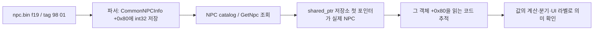

# NPC f19의 의미를 코드 사용처로 추적

2026-10-09. **숫자 모양보다 실제 객체의 값이 어디에서 어떻게 쓰이는지를 추적해야 한다.** 현재 f19의 저장·조회 경로를 원본 코드에서 확장 검증했다. AC 의미를 직접 확인하지 못했으며, 구버전 명명 데이터와 비교하면 lawful/성향 가설이 더 강하다. 현재 NC에서의 속성 이름은 아직 미확정이다.

## 추적 방법과 확인된 경로

1. wire tag를 파서 엔트리에 연결한다. `CommonNPCInfo`의 parser `6901F0`에서 parse table `15E17D0`과 dispatcher `DEDF80`으로 간다. f19 엔트리 `15E1930`은 decoder `DEC5D0`, coded tag0198, 존재 비트18, object offset80이다. 단일 바이트는 `DEC620`, 여러 바이트/음수는 `DE9210→DE93D4`에서 low32를 저장한다.
2. 실제 객체 타입과 포인터 출처를 닫는다. RTTI `173C8F0`과 vtable `11DE438`을 확인했다. 생성/clear는 f19을0으로 만들고 copy `690FB7→690FBD`는 같은+80 값을 옮긴다. serializer `69064D`는 MOVSXD로 signed32를64비트로 부호 확장해 field19로 기록한다.
3. 조회 함수의 반환 형태를 확인한다. `GetNpc 3722B0`의 RCX는 catalog, RDX는16바이트 결과 저장소, R8D는 ID다. 성공하면 저장소 첫 qword가 raw NPC, 두 번째가 shared control이다. **RAX는 결과 저장소 주소이며 raw NPC 포인터가 아니다.** 따라서 RAX+80을 무작정 검색하면 다른 객체를 추적할 수 있다.
4. 실제 NPC 포인터를 읽은 뒤 해당 포인터의 별칭·복사·인자 전달을 따라간다. parser/serializer/copy의 읽기는 숫자 보존을 증명하지만 사람용 의미는 증명하지 않는다. AC 관련 계산/표시, 성향 관련 로직/라벨 등과 실제 데이터 흐름이 연결되어야 의미를 명명한다.

## 이번 소비 경로 조사 결과

현재 코드 전체17.5MB의 direct CALL/JMP/RIP/table pointer 후보를 조사했다. 정확한 direct GetNpc 호출자는3개다.

| 함수 | 실제 raw NPC 포인터 | 확인된 읽기 |
|---|---|---|
| 43BCA0 | 43BEA3에서 결과 저장소 첫 포인터 | +84/f22와+8F/f26 조건 분기 |
| 527A20 | 527A7F에서 결과 저장소 첫 포인터 | +30/f3 이름 문자열→서식 함수 |
| B1E4F0 | B1F4BC에서 결과 저장소 첫 포인터 | +30/f3 이름 문자열→서식 함수 |

이 세 경로에서 f19의 의미 사용은 확인되지 않았다. B1E4F0의 Level 문자열은 GetNpc 호출보다 앞선 별도 경로라 f19나f23의 레벨 의미로 삼지 않았다. 다른 GetNpc 문자열이 있는4CBD60은 catalog+348의 다른 map이어서 NPC map+480과 구분했다.

같은+80 오프셋의 실제 메모리 접근3,131개와 catalog 관련557개를 분류했고, 짧은 getter 후보는 MovingAction·ActionTimeline·ATSConfig BuffData로 판별했다. **다른 클래스의+80을 NPC f19로 합치면 안 된다.** 이 조사로 모든 inlined/virtual/간접 소비의 부재나 서버 전용 속성임을 증명한 것은 아니다.

## AC와 lawful 가설을 구분하는 데이터

낮은 AC가 높은 방어를 뜻하므로 음수와 역상관은 AC 가설을 세울 이유가 될 수 있다. 그러나 이름 있는 별도 데이터로 대조하면 다음 차이가 있다.

| 몬스터 | 현재 f19 | 구버전 L1J AC | 구버전 L1J lawful |
|---|---:|---:|---:|
| 오크 ($59) | -2 | 10 | -2 |
| 해골 ($7) | -12 | 3 | -12 |
| 데스나이트 ($371) | -120 | -67 | -120 |
| 장로 ($19) | 200 | -5 | 200 |

[핀된 L1J NPC DB](https://github.com/l1j-en/classic/blob/103e6f6c9dd83545959d8e87d3f59f8de1f40ef0/db/l1jdb_m10.sql)는 ac와lawful을 별도 컬럼으로 정의한다. [NpcTable loader](https://github.com/l1j-en/classic/blob/103e6f6c9dd83545959d8e87d3f59f8de1f40ef0/src/l1j/server/server/datatables/NpcTable.java#L102)도 서로 다른 setter로 읽는다. 현재 표시 토큰과 대응하는703행에서 후보 lawful 값과는368행, AC와는49행이 일치했다. 원본 후보가 여러 개인 행은 any-match이므로 이를 의미 확정 확률로 해석하지 않는다.

현재 NPC951행 중 음수433/0값258/양수260이고, 상점·군터 등에서 양수1000이220개다. 값 분포도 AC 하나로 해석하기에는 추가 설명이 필요하다. 구버전 경비병·군터·보호자 값은 현재와 다른 사례를 보존했다. **이 L1J 자료는 예전 US 클라이언트를 대상으로 하는 에뮬레이터이며 현재 NC 서버/클라이언트가 아니다.** 값 이식이나 원본 의미의 확정 근거로 사용하지 않는다.

현 단계에서는 f19를 AC로 사용하지 않고 **lawful/성향을 우선 검증할 가설**로 유지한다. 확정하려면 원본의 실제 f19 소비 코드와 의미 라벨/계산을 연결하거나 원래 명명 스키마를 확보해야 한다. 실행 중 추적이 필요할 경우에도 현재 소유·타입·객체 주소를 먼저 확인하고 대상+80의 읽기 사용처를 봐야 하며, 파싱/copy 읽기를 의미 사용으로 혼동하지 않는다. 이번에는 게임·메모리·실행 중 breakpoint를 사용하지 않았다.

## 재현 자료와 검증

- [파서·타입·copy 경로](../work/npc_f19_semantics/type_routes/report.json).
- [GetNpc ABI와 실제 소비 경로](../work/npc_f19_semantics/consumers/semantics.json), [스캔 범위](../work/npc_f19_semantics/consumers/report.json).
- [AC/lawful 대조](../work/npc_f19_semantics/hypotheses/README.md)와10개 원시 표본·703행 후보 집합.
- [Root 독립 검증4,333개 PASS](../work/npc_f19_semantics/root-review.json): 저장된 함수·명령/파서 엔트리·vtable·타입 경로를 현재 원본에서 다시 읽고, 별도 공개 GET의 정확 SHA로 고정된 SQL을 다른 CSV 파서로 재해석해 named AC/lawful과 표본·703행 후보값을 대조했다. 전체 SQL은 산출물에 복사하지 않았다.

CONTROL·복원7records·기존 입력 핀 불변이며 원본·보관·제품·서버 룰·키·게임·메모리·UAC 변경은 없다.
